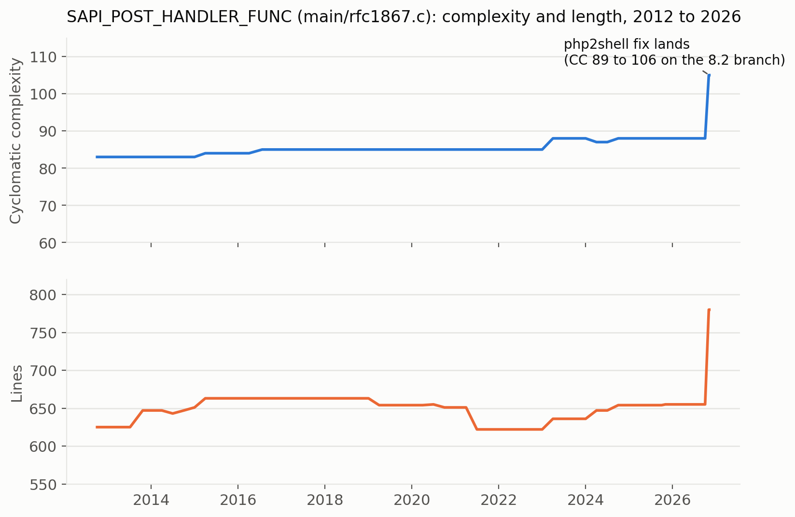
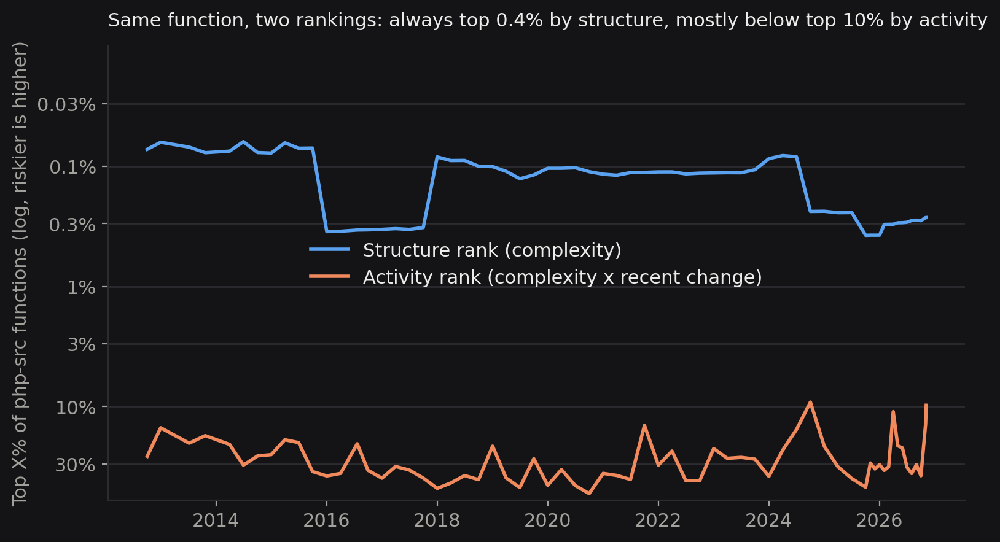
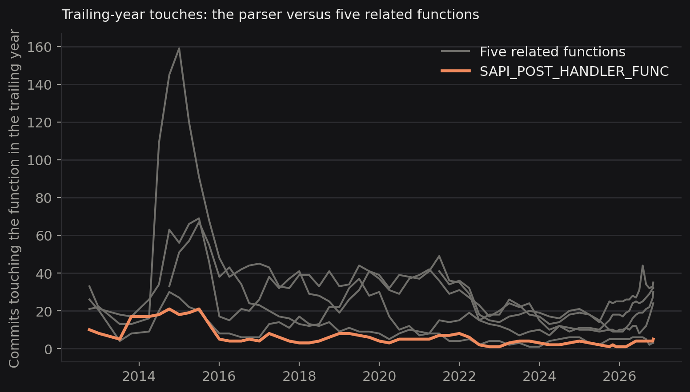

In October, PHP shipped fixes for two remote code execution bugs that researchers call php2shell, [CVE-2026-109618](https://github.com/php/php-src/security/advisories/GHSA-w8hw-w9fx-j79w) (out-of-memory corruption) and [CVE-2026-109619](https://github.com/php/php-src/security/advisories/GHSA-6wmf-4rv5-p3rp) (stale global state). Both were fixed in one commit, [`3584a98bd`](https://github.com/php/php-src/commit/3584a98bda0f2c0d367255b046798b0d3a221a19). One of the code paths the advisory names is the multipart request parser, `SAPI_POST_HANDLER_FUNC` in `main/rfc1867.c`.

I pointed hotspots at that function's history. The short version: the parser was one of the most complex functions in php-src for 14 years and rarely changed, so a complexity ranking could see it and an activity ranking could not. The root cause of php2shell was invisible to both. This is a descriptive study, not a claim that the tool predicts vulnerabilities. [The standard analysis of php-src at the head commit is here.](/blog/2026-11-06-php-php-src) This post uses a full clone (150,291 commits since 1999), hotspots 3.3.3, and 65 sampled commits from October 2012 to now.

## A 600-line function that rarely changed

For 14 years the parser's cyclomatic complexity sat between 83 and 88 and its length between 622 and 665 lines. The only big step is the fix itself: on the PHP-8.2 branch the patch took it from CC 89 to 106 and from 643 to 768 lines, mostly by adding limits.

Both rankings below are function-level, among all php-src functions in each sample. By structure (complexity alone) it was in the top 0.4% every time (8th to 77th). By activity, which also weighs how much and how recently code changes, it ranged from the top 9% to the top 53%. It was touched only 1 to 21 times in any year, while five related functions (`php_error_cb`, `zend_error_zstr_at`, `zend_mm_alloc_pages`, `php_register_variable_ex`, `zend_call_function`) drew more in most years, some of them over 100.

My first draft stopped here with a tidy conclusion: activity-weighted ranking underrates complex, quiet code like this. That turned out to be incomplete.

## So does the ranking miss this kind of code?

To find out, I collected 85 past security fixes (commits citing a CVE or GHSA since 2013) and 1,060 bug-labelled GitHub fixes since 2021 that touch one to four C files. For each, I ran hotspots on the parent commit and asked two questions.

**Which function in the file got fixed?** The more complex one, usually. The fixed function is structurally riskier than its same-file neighbors in 61 of 74 CVE fixes and 698 of 802 GitHub fixes (87%). Recent activity gets 59 and 681. Of the fixed functions, 46% sit in the top 10% of php-src by structure, against 13% of their neighbors. Part of that is length: against same-length neighbors the gap shrinks to 39% versus 35%.

**Which file got fixed?** The active one. For 1,137 fix commits with a rankable C file, I ranked the file that was later fixed against every other C file at the parent commit.

Using each file's highest-scoring function, the fixed file's median percentile (50 is chance, lower is riskier) was 7.6 by activity and 16.4 by structure. In the top 10% were 56% of fixed files by activity and 33% by structure. Recent touches did about as well as activity (9.8), and plain file size did well too (13.4, with 42% in the top 10%), which matters below.

Activity ranked the fixed file as riskier than structure in 725 commits against 405. The GitHub set drives that (687 against 361). In the 83 CVE fixes the two are level, which is too few to separate them, and 2013 to 2021 has too few commits (29) to say. Compared only with files of similar length, structure falls to near chance (45.9) while activity keeps most of its edge (21.4). The JIT and opcache fixes land in files at the top by both measures; in DOM and SPL activity wins by a wide margin. Those category samples are small, so treat them as leads.

Put together, the useful reading is two steps: use activity to choose which files to open, then use complexity to choose the function to read first. The multipart parser is the case where that breaks. `main/rfc1867.c` ranks 129th of 1,574 files by total activity risk today, unremarkable for a quiet file, so step one would not have sent you there. Its main function is the 74th most complex of 27,738, so complexity on its own would have. Neither step on its own is enough: a quiet, complex, untrusted-input handler in a file nobody is touching only surfaces if you read the complexity column directly.

## What no function metric sees

The twist is that the php2shell patch did not mainly fix the parser. It touched about 295 functions across the allocator, hash table, string and SAPI layers. The root cause was a design assumption: bailing out of a request with `longjmp` through code that was not written for it. That is a cross-cutting property of the whole engine. A ranking can tell you where to read first. It cannot tell you that a codebase-wide convention is unsafe.

So the parser was visible to complexity ranking, invisible to activity ranking, and the actual flaw was invisible to both. That is a reason to keep complexity visible next to activity instead of folding everything into one score, and to read a ranking as a place to start reading, not a verdict.

## What this does not show

- It measures where fixes landed. It does not show which unfixed functions hide bugs, and I did not test prediction.
- Active files attract bug fixes for ordinary reasons (people are working there), so activity ranking a fixed file highly is not the same as predicting an unknown bug.
- Fix commits cluster in time and repeat in the same files, so p-values in the underlying tests overstate independence. I counted only fixes touching one to four C files with a bug label or CVE reference, which favors focused fixes.
- php-src more than doubled (about 11,100 to 27,700 functions) while I tracked the parser, so rankings are relative to a moving repository.
- F160: activity terms matter more than complexity when ranking files, which matches the file-level result above.

## Where to start

1. Read `SAPI_POST_HANDLER_FUNC` in `main/rfc1867.c` with the advisory open, and check each header, file-control and nested-name limit against the limits the patch relies on.
2. Walk `php_error_cb` and `zend_error_zstr_at` for state they publish that a later request could read before `RINIT` resets it.
3. When you triage your own repo, rank files by activity first, then read the most complex function in each.
4. Reproduce: `git checkout 80dd1a3`, then `hotspots analyze . --mode snapshot --force`. The history runs use the same command at each sampled commit.
